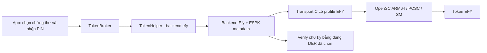

# Kế hoạch tích hợp EFY-CA native ARM64 vào TokenSigner

Ngày: **2026-10-23**. Trạng thái: **đã đọc chứng thư và xác thực PIN EFY thật thành công trên ARM64; chưa ký, chưa sửa Sources/app**. Đây là kế hoạch triển khai sau phép thử PIN người dùng yêu cầu.

## Kết quả làm cơ sở quyết định

- [A01–A05](efy-ca-arm64-native.md): OpenSC 0.27.1 ARM64 đọc catalog ESPK, DER và metadata; parser Core hiện có ghép đúng một identity RSA-2048, public key khớp chứng thư.
- [B01](evidence/efy-ca-pin-static.json): thư viện EFY dùng `SHA1(raw PIN bytes) || BE32(raw byte count)`. Có primitive challenge/external-auth trong cùng artifact. Chưa trace nhánh vtable của vendor `C_Login`; không coi toàn bộ call-flow đó đã được chứng minh.
- **[B02](evidence/efy-ca-arm64-auth-result.json): người dùng nhập PIN qua NSSecureTextField cục bộ; helper ARM64 gửi đúng một lần xác thực, nhận `SW=9000`. Reset/unlock/disconnect đều `rv=0`; `signatures=0`.** Phép đo thực chứng minh đường challenge-auth tương thích với mẫu EFY này.
- Profile đã đo: ATR `3b9f958131fe9f006646530510113971df00005100006a`, driver `epass2003`, private-key reference từ metadata là `A020`. Không mở rộng sang mọi EFY chỉ vì byte customer `0x51`.

**Quyết định:** thêm backend EFY native qua OpenSC/PCSC + ESPK. Không cần Windows/Parallels hoặc EFY dylib Intel cho đường đã đo. Chưa bật khả năng ký EFY trong bản app phát hành trước khi có chữ ký thử được kiểm chứng độc lập.

## Thiết kế đích

Giữ `TokenBackend` và JSON helper contract hiện có. EFY dùng `tokenScope: .reader`; discovery dựa trên profile đầy đủ, danh tính ổn định dựa trên cardid, không dựa trên số thứ tự reader/slot. Không lấy chứng thư của token khác đang cắm để gắn vào EFY.

## 1. Chuẩn hóa profile và transport chung

| File | Thay đổi dự kiến |
|---|---|
| `Sources/Core/EfyProfile.swift` — mới | ATR đầy đủ của mẫu đã đo, tên EFY và policy RSA-2048/ESPK. Ban đầu chỉ hỗ trợ profile này. |
| `Sources/Core/ModuleRegistry.swift` | Thêm `.efy` trong `ModuleBackend`; kiểm tra `EfyProfile.atr` trước lookup customer byte, module logic `EFY-ESPK`, `.reader`, `isExperimental: true`. Không route EFY sang `.fastca`. |
| `Sources/CFastCA/include/cfastca.h` | Thêm entry point chọn profile bằng enum nội bộ `FASTCA`/`EFY`; giữ `fca_card_open` cũ là wrapper FastCA để giảm thay đổi caller hiện có. |
| `Sources/CFastCA/fastca.c` | Tách kiểm tra ATR khỏi `fca_card_open`; table profile cố định trong C, xác minh lại ATR sau connect, driver và version runtime trước auth. Reuse select/read/challenge/SM, không nhận ATR tùy ý từ web/helper request. |
| `Sources/Core/FastCAProfile.swift` | Chuyển `ESPKSigningIdentity` sang file Core riêng nếu cần; giữ nguyên logic parser/resolver đã chạy trên EFY, không nhân bản parser. |

Giai đoạn này giữ tên target `CFastCA`/prefix `fca_` để tránh đổi ABI và build trên diện rộng; nội dung dùng chung được phân tách theo profile. Có thể đổi tên target sau một thay đổi riêng. Không thêm dependency mới chỉ để phục vụ EFY.

**Điều kiện hoàn tất:** routing chỉ nhận exact EFY profile; FastCA và OneCA giữ route hiện tại; C từ chối token sai dù caller truyền đúng tên reader. Metadata reads vẫn giới hạn FID công khai, không đọc EF chứa khóa `Axxx`/`8xxx`.

## 2. Backend EFY và vòng đời PIN

Thêm `Sources/TokenHelper/Efy.swift`, tuân theo `TokenBackend`:

1. `listTokens/certs`: parse catalog `3F00/2003/6F01`; tìm logical `cardid`, `pkcs11/cert*`, `pkcs11/prvk*`. Không hardcode `24C0` hoặc `A020` vào backend tổng quát. Harness PIN dùng FID/fingerprint mẫu chỉ là chốt kiểm tra cho nghiên cứu.
2. Tạo serial namespace `EFY-` từ hash cardid, ổn định qua hotplug/gia hạn chứng thư. Không dùng slot index làm identity. Từ chối cardid rỗng, catalog lỗi/duplicate hoặc identity mơ hồ.
3. Ghép exact `CKA_ID`, class/type/sign capability; kiểm tra modulus/exponent từ metadata với public key DER bằng `RSAPKCS1v15.certificateMatches` trước PIN. Fingerprint chứng thư là của identity người dùng chọn, không hardcode chứng thư nghiên cứu vào production.
4. `login`: mở lại đúng token/reader, đọc lại snapshot; xác minh serial và tập identity hợp lệ, chỉ nhận phạm vi ASCII đã hỗ trợ. Contract hiện tại login chỉ nhận serial; khi `sign` nhận certId phải chọn đúng identity trong snapshot đã kiểm tra, không chuyển sang cert/key khác. Derive `SHA1(raw bytes) || BE32(count)`, lấy challenge8, 3DES CBC IV0 → cryptogram8; gửi một `00 82 01 81` qua SM. Không pad PIN đến16, không thử công thức khác khi thất bại.
5. Đặt cờ đã thử **trước transmit**; không tự retry/fallback và đặt `NO_RETRY_WL`/`NO_GET_RESP`. Wipe buffer có thể kiểm soát; không ghi PIN, derived key, challenge/cryptogram hoặc SM key vào logs. Không bảo đảm xóa mọi bản sao String do Swift/AppKit quản lý.
6. Auth thành công giữ connection + snapshot trong đúng helper process cho một thao tác ký. Auth lỗi hoặc transport không rõ kết quả: đóng/reset và trả lỗi; không chuyển sang vendor middleware để thử PIN lần nữa.
7. `logout`, cancel, disconnect/hotplug, sign xong hoặc sign thất bại: reset và giải phóng phiên. Nếu helper bị kill/crash, trạng thái auth trên thẻ không được mặc định là đã xóa; phiên kế tiếp phải reset/preflight lại trước khi dùng, không tái sử dụng trạng thái cũ.

`63Cx` có thể trả số lần còn lại theo SW; chỉ hiển thị số đó nếu thực sự nhận được. `6983` là trạng thái khóa theo profile. Transport lỗi hoặc SW khác phải hiển thị đúng tình trạng chưa xác định, không suy diễn là PIN sai. Khi chưa có thông tin retries, dùng `PIN_RETRIES_UNKNOWN`; không thử PIN sai trên token thật để kiểm tra UI.

## 3. Chứng minh đường ký trước khi bật trong app

**Chưa thực hiện trong lượt PIN này.** Cần một phép ký dữ liệu thử cục bộ với người dùng chủ động nhập PIN, không gửi hồ sơ nghiệp vụ.

- Resolve lại key reference từ metadata matched identity. Candidate MSE: `00 22 41 B8`, payload `80 01 84 81 02 <keyRefBE16>`; mẫu hiện tại cho `A0 20`.
- Chuẩn bị SHA-256 DigestInfo + PKCS#1 v1.5 block256 byte trên host; candidate PSO `00 2A 80 86` qua SM. Chưa coi hai lệnh này đã được EFY chấp nhận chỉ nhờ FastCA/OpenSC.
- Không dùng high-level `epass2003_set_security_env` mặc định vì nó map sang `2900 + 20*ref`, khác ESPK `A020` đã đọc.
- Chỉ trả thành công khi có signature256 byte và verify bằng **đúng DER đã chọn** thành công. Dữ liệu bị đổi/chứng thư khác phải verify thất bại trong kiểm tra offline, không cần ký thêm trên token.
- Chỉ công bố `sha256RSA`/`rsaPKCS` sau khi kiểm tra semantics với `SignMech`; `rsaX509` và các độ dài/thuật toán khác trả unsupported đến khi có bằng chứng.
- Sau lần ký, reset/logout; thử đọc lại không PIN để xác nhận kết nối phục hồi. Không dùng thêm một signature không PIN để kiểm tra logout.

**Điều kiện hoàn tất:** evidence ghi hash dữ liệu thử, DER fingerprint, signature length, kết quả verify độc lập, SW và cleanup; không chứa PIN/secret. Nếu MSE/PSO thất bại, quay lại static analysis và dừng tính năng ký EFY; không brute-force protocol bằng nhiều lệnh khóa.

## 4. Nối vào helper, broker và app thử nghiệm

| File/nhóm | Thay đổi dự kiến |
|---|---|
| `Sources/TokenHelper/main.swift` | Route `--backend efy` tạo `Efy()` không cần `--module`; báo lỗi tham số rõ ràng. |
| `Sources/Core/TokenBroker.swift` | Nhánh `.efy` chạy native helper, không `arch -x86_64`; loại biến injection/debug như đường FastCA. Login/sign/logout cùng một spawn. |
| `Sources/App` và các bridge dùng broker | Dùng CA label/profile từ registry, chọn đúng serial/certId; tái sử dụng PIN prompt, lỗi PIN/transport và confirm signing hiện có. Kiểm tra bridge không tự lặp request login khi nhận lỗi. |
| `scripts/test-env.sh`, `scripts/package-test-app.sh` | Chuẩn bị runtime ARM64 đã kiểm tra cho EFY; package vào fixture riêng, không ghi đè bundle đang chạy. |
| Script kiểm tra bundle | Kiểm tra kiến trúc, dependency closure OpenSC/libcrypto/libz, version ABI, relocation, codesign và thông báo bản quyền đi kèm. Không phụ thuộc ngầm vào Homebrew trên máy người dùng. |

Runtime nghiên cứu hiện là `/opt/homebrew/Cellar/opensc/0.27.1/lib/libopensc.13.dylib`; version/hash trong B02. Đường Homebrew này phục vụ thử trên máy hiện tại. Khi phân phối phải kiểm tra bản build đóng gói với cùng ABI/profile, bao gồm dependency ARM64, hoặc chủ động báo thiếu runtime trước PIN. Không tải/cài runtime khi người dùng đang nhập PIN.

## Kiểm thử và tiêu chí chấp nhận

| Tầng | Kiểm tra cần thiết |
|---|---|
| Core offline | Exact EFY ATR được nhận; biến thể ATR/customer byte đơn lẻ bị từ chối; FastCA/OneCA vẫn đúng. Catalog FID đổi vị trí vẫn resolve đúng; duplicate ID/key/cert và mismatch public key bị từ chối. Dùng fixture tổng hợp/ẩn danh. |
| C/backend với transport giả | Không transmit auth nếu preflight lỗi; chỉ một auth call khi SW lỗi/transport lỗi; cleanup sau attempted auth; không sign trước login hoặc với identity khác; reset khi sign/error/cancel. Không thử PIN sai trên thẻ thật. |
| Helper/broker | `--backend efy` không resolve Intel dylib và không inject shim; login/sign/logout cùng process; lỗi login không tạo signature; PIN không có trong argv/log/error. |
| Phần cứng EFY | Read đã PASS; PIN đã PASS; tiếp theo ký dữ liệu thử + verify. Hotplug/reader đổi số không ghép nhầm identity, thao tác song song cùng token bị tuần tự hóa. |
| Hồi quy app | Chạy `swift test`; smoke bundle/bridges read-only và routing FastCA/OneCA/PKCS11 hiện có. Hardware tests của CA khác chỉ chạy khi có yêu cầu phù hợp, không tự hỏi PIN để hồi quy. |
| App fixture | Menu thấy EFY và đúng chứng thư; một lần nhập PIN → một chữ ký verify được; UI hủy/thiếu runtime/lỗi transport không tự gửi lại PIN; app/bridge kết thúc clean. |

Trước khi package/smoke cần kiểm tra app và port đang dùng; script hiện tại có thể thay bundle hoặc khởi động signer. Phối hợp với công việc khác trong checkout, chạy fixture EFY riêng khi cần. Không dừng app đang chạy chỉ để hoàn tất tài liệu kế hoạch.

## Thứ tự triển khai đề xuất

1. Profile EFY + refactor transport có giới hạn + backend enumeration. Hoàn tất test routing và metadata trước khi nối PIN.
2. Đưa auth đã đo vào backend, kiểm tra state machine và cleanup bằng transport giả. Thêm route helper/broker.
3. Phép ký dữ liệu thử cục bộ và verify độc lập; xử lý bất kỳ khác biệt EFY MSE/PSO trước bước tiếp.
4. Đóng gói app fixture ARM64, smoke UI/bridges và hồi quy; giữ EFY experimental trong lần tích hợp đầu. Kiểm thử cổng nghiệp vụ là mốc riêng sau khi ký cục bộ pass.

Đường lui cho thay đổi production: tắt route EFY/experimental feature; không thay driver, firmware, PIN hoặc cấu trúc token. **Việc đã hoàn tất trong lượt này là phép thử PIN và kế hoạch này; triển khai Sources và phép ký thử vẫn là công việc tiếp theo.**
