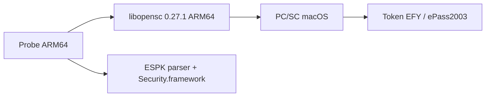

# EFY-CA trực tiếp trên macOS ARM64

Ngày: **2026-10-23, Asia/Ho_Chi_Minh**. Nghiên cứu tiếp từ [installation và middleware EFY](efy-ca-windows.md). Giai đoạn A chỉ đọc; giai đoạn B theo yêu cầu người dùng đã thử PIN bằng prompt cục bộ. Không sửa Sources/bundle TokenSigner, không chạy bộ cài, ký hoặc ghi dữ liệu bền vững lên token.

**Đã chứng minh đường ARM64 đọc được chứng thư EFY thật qua OpenSC + PC/SC.** Probe và runtime đều ARM64, không nạp dylib Intel EFY, không đi qua Rosetta/Windows. Đọc được catalog ESPK, metadata public/private-key object và DER; parser hiện có của dự án ghép được đúng certificate/key và Security.framework xác nhận public key khớp.

**Cập nhật B02: PIN EFY đã xác thực thành công trên ARM64, `SW=9000`, một lần auth; reset/unlock/disconnect đều thành công.** Người dùng nhập PIN tại NSSecureTextField, helper nhận qua stdin pipe. Không ghi PIN vào chat/log/file, không ký. [Kết quả auth](evidence/efy-ca-arm64-auth-result.json), [kế hoạch tích hợp vào app](efy-ca-app-plan.md).

Đường triển khai được ưu tiên là **backend EFY native dựa trên transport ESPK hiện có**. Phần chưa được chứng minh là chữ ký EFY và tích hợp end-to-end trong app; kết quả đọc/PIN thành công không thay thế phép thử ký.

## Bằng chứng

| ID | Hồ sơ | Loại |
|---|---|---|
| EFY-CA-A01 | [arm64-runtime](evidence/efy-ca-arm64-runtime.json) | Chạy thật probe ARM64 trên token EFY, chỉ đọc |
| EFY-CA-A02 | [arm64-metadata](evidence/efy-ca-arm64-metadata.json) | Parse các attribute đã đọc; không chứa raw DER/subject/serial |
| EFY-CA-A03 | [arm64-parser-validation](evidence/efy-ca-arm64-parser-validation.json) | Dùng nguyên parser/identity resolver/Core và Security.framework |
| EFY-CA-A04 | [arm64-source-evidence](evidence/efy-ca-arm64-source-evidence.json) | Source OpenSC 0.27.1, hash runtime và giới hạn suy luận |
| EFY-CA-A05 | [arm64-validation](evidence/efy-ca-arm64-validation.json) | Kiểm tra artifacts, metadata association, kiến trúc, links và scope |
| EFY-CA-B01 | [pin-static](evidence/efy-ca-pin-static.json) | Disassembly artifact EFY: raw PIN transform, primitive challenge/3DES |
| EFY-CA-B02 | [arm64-auth-result](evidence/efy-ca-arm64-auth-result.json) | PIN EFY thật qua UI/helper ARM64; SW9000, một auth, reset thành công |
| EFY-CA-B03 | [auth-validation](evidence/efy-ca-auth-validation.json) | Đối chiếu source/binary/runtime hashes, links, permissions và kết quả |

Source probe: [C reader](evidence/efy-ca-arm64-probe.c), [Swift metadata check](evidence/efy-ca-arm64-metadata-check.swift). Raw data để trong thư mục bỏ qua Git `.local/efy-ca-windows/arm64/private`, permission directory 0700/files 0600. Chỉ metadata của object khóa được đọc; không đọc EF chứa khóa bí mật `Axxx`/`8xxx`, không xuất private key.

Các ID trên là local analyst evidence, không phải REA Evidence IDs. Lượt này phân tích source/disassembly và chạy harness tự viết; không có pseudocode native mới do REA trả về. Các giới hạn Hopper của lượt trước vẫn giữ trong báo cáo middleware. A01–A05 là snapshot giai đoạn chỉ đọc; các trường “chưa thử PIN” trong evidence A được cập nhật bằng B01–B03, không viết lại lịch sử phép đo.

## 1. Kiến trúc thực sự đã chạy



**[O; A01, A04]** Runtime là `/opt/homebrew/Cellar/opensc/0.27.1/lib/libopensc.13.dylib`, `Mach-O … arm64`; probe cũng là `Mach-O … arm64`. Link dependencies của probe là OpenSC và libSystem; không có dependency EFY Intel. Đây là native ARM64 với thư viện transport OpenSC, chưa phải transport tự viết hoàn toàn.

OpenSC đã có [driver ePass2003 ở tag 0.27.1](https://github.com/OpenSC/OpenSC/blob/0.27.1/src/libopensc/card-epass2003.c); [wiki upstream](https://github.com/OpenSC/OpenSC/wiki/Feitian-ePass2003) mô tả họ thiết bị CCID. Source driver xử lý ATR, secure messaging, chọn/đọc file và primitive RSA. Điều này cung cấp nền tảng; tính tương thích với personalization EFY phải được chứng minh riêng bằng phép đo bên dưới.

Probe tự chọn **duy nhất reader có đúng ATR EFY đã quan sát**, xác minh lại ATR/driver sau connect, dùng transaction trong thời gian đọc rồi đóng/release. Debug APDU bị tắt; không log PIN, derived secret hoặc SM key. OpenSC có thiết lập mutual authentication/secure messaging cho transport; đây không phải xác thực PIN người dùng. Không dùng generic PKCS#11 của OpenSC trong phép đo này.

## 2. Kết quả trên token EFY thật

**[O; A01]** Reader tại thời điểm đo: `FT ePass2003Auto 02`.

```text
ATR = 3b9f958131fe9f006646530510113971df00005100006a
OpenSC version = 0.27.1
card driver = epass2003
connect = 0
lock = 0
select 3F00/2003/6F01 = 0
read catalog = 1500 / 1500 bytes
```

Catalog là 50 records × 30 byte, cùng format `ESPKCatalog` hiện có. Đọc được **7 logical files**:

| Logical file | FID trên thẻ này | Đã đọc nội dung |
|---|---|---|
| `mscp/cmapfile` | `2400` | Chỉ thấy entry |
| `internal/containermap` | `2420` | Chỉ thấy entry |
| `tkinfdir/tokeninfo` | `2440` | Chỉ thấy entry |
| `cardid` | `2460` | 16 B; giá trị không đưa vào repo |
| `pkcs11/pubk0001` | `2480` | 477 B metadata |
| `pkcs11/prvk0001` | `24A0` | 510 B metadata, không phải private key material |
| `pkcs11/cert0001` | `24C0` | 1,941 B attribute container, gồm DER 1,317 B |

**Không hardcode FID của thẻ này trong backend tổng quát.** Thứ tự khác FastCA đã khảo sát: certificate EFY ở `24C0`, trong khi thẻ FastCA trước đây ở `24E0`. Luôn parse catalog rồi tìm logical name.

**[O; A02, A03]** Association đã kiểm tra:

- Certificate class `1`, public-key class `2`, private-key metadata class `3`.
- `CKA_ID` của cả ba giống nhau; evidence chỉ giữ SHA-256 của ID.
- Metadata private-key object có `CKA_SIGN=true`, RSA modulus 256 B, exponent `010001` (65537).
- Vendor attribute `0x80000100` của private-key metadata là **`A020`**; public-key object báo `8000`. Phải dùng tham chiếu private-key metadata khi ký.
- Resolver hiện có tìm được **1 signing identity**, RSA **2048 bit**.
- `RSAPKCS1v15.certificateMatches` bằng Security.framework trả **true**. Đây là so sánh public key trong X.509 với modulus/exponent metadata; chưa phải bằng chứng possession bằng chữ ký.
- DER SHA-256 `82d02509715e7273639db37d62c364eaf54cfb15ff9fdf79f10c609ea66515c9`.
- Issuer: **EFY-CA SHA256 R1**. Khoảng thời gian trong DER: 2026-08-06 → 2027-08-06. Chưa kiểm tra chain, revocation hoặc chấp nhận từ cổng nghiệp vụ.

## 3. Những phần tái sử dụng được trong TokenSigner

**[O]** Đã compile riêng và chạy nguyên các file Core sau trên metadata EFY, không sửa implementation:

- `Sources/Core/ESPKCatalog.swift`: parser catalog và attribute containers.
- `Sources/Core/FastCAProfile.swift`: `ESPKSigningIdentity.resolve` (tên file chứa FastCA, nhưng resolver nhận metadata tổng quát).
- `Sources/Core/RSASignature.swift`: đối chiếu public key chứng thư.

**[I]** Những thay đổi production có thể thực hiện sau nghiên cứu:

| Thành phần | Hướng thay đổi đề xuất |
|---|---|
| `ModuleRegistry` / profile | Thêm profile EFY và backend riêng; kiểm tra ATR/profile đầy đủ trước thao tác. Byte `0x51` chỉ dùng để nhận diện ban đầu |
| C transport đang ở `CFastCA` | Tách phần chung thành transport ESPK nhận expected ATR/profile. Giữ kiểm tra version ABI OpenSC và driver `epass2003`; hiện `fca_card_open` hardcode ATR FastCA nên không gọi nguyên hàm đó với EFY |
| Swift backend | Thêm `Efy` theo `TokenBackend`, dùng catalog → attributes → identity resolver; token serial từ hash cardid có namespace EFY |
| Certificate enumeration | Trả chứng thư từ đúng matched identity và reader; không dùng slot number làm danh tính token |
| Broker/helper | Thêm route native EFY. Cùng process session cho login/sign/logout; không inject vendor PKCS#11 shim vào đường OpenSC |
| Distribution | Cố định runtime ABI đã dùng, đóng gói các dependency ARM64 cần thiết trong fixture riêng trước khi phân phối |

Những thay đổi trên **chưa được áp vào Sources hoặc app**. Thành công của harness không tự làm menu/app hỗ trợ EFY.

## 4. Phần xác thực và ký cần làm thế nào

**[O nguồn; A04]** Driver OpenSC có các primitive thiết lập secure messaging và RSA. Tuy nhiên high-level `epass2003_set_security_env` mặc định dựng FID theo `0x2900 + 0x20 * key_ref[0]`, khác tham chiếu ESPK **A020** đã đọc trên EFY. Vì vậy không mặc định gọi high-level `sc_set_security_env` với ID PKCS#11 hoặc số `A020` rồi coi mapping đã đúng.

**[I; auth đã chạy, sign chưa chạy]** Hướng tích hợp là giữ OpenSC làm transport/SM, thêm lớp ESPK cho personalization EFY:

1. Mỗi lần mở phiên xác minh đúng ATR, cardid và certificate/key association, đọc lại key reference từ metadata.
2. **Đã xác định và thử thành công:** `SHA1(raw ASCII PIN bytes) || BE32(raw byte count)`, không padding16. B01 xác nhận raw pointer/count trong EFY middleware và primitive challenge/3DES; B02 chứng minh đường challenge-auth tương thích EFY thật. Chưa trace indirect vtable để khẳng định vendor `C_Login` luôn chọn cùng nhánh nội bộ.
3. **Đã chạy B02:** challenge8 → 3DES EDE3 CBC IV0 → external-auth `00 82 01 81`, Lc8 qua SM; một lần `sc_transmit_apdu`, nhận `9000`, reset/unlock/disconnect đều `0`. Không fallback hoặc retry. Gắn phiên app tương lai với đúng token/identity và wipe buffer có thể kiểm soát.
4. Chọn key EF đã xác minh bằng MSE qua transport SM; candidate frame theo họ ESPK là `00 22 41 B8`, payload `80 01 84 81 02 A0 20`. **Chưa gửi lệnh này trên EFY.**
5. Host tạo SHA-256 DigestInfo + PKCS#1 v1.5 block 256 B; candidate RSA primitive là PSO `00 2A 80 86` qua SM. **Chưa gửi PSO/ký trên EFY.**
6. Chỉ chấp nhận signature sau khi verify bằng public key của đúng DER đã chọn. Việc verify toán học và kiểm tra chứng thư/cổng nghiệp vụ là các bước khác nhau.

Source generic OpenSC đặt cấu hình padding16 trong PIN-info; phép thử EFY B02 tự derive từ raw PIN theo artifact EFY và đã thành công. Không sử dụng `sc_pin_cmd` để tự padding PIN hoặc thử nhiều công thức. Thành công này chỉ áp dụng profile/mẫu đã đo, chưa mở rộng ra mọi EFY.

Không có phép `sc_pin_cmd`, `fca_login`, MSE, PSO hay signature EFY trong harness đọc. Harness auth riêng: [C helper](evidence/efy-ca-arm64-auth-probe.c), [PIN prompt Swift](evidence/efy-ca-arm64-pin-prompt.swift). UI/helper/runtime đều ARM64; không dùng debugger/observer khi nhập PIN. C helper kiểm tra lại exact ATR + DER fingerprint sau connect, khóa transaction, tắt debug, cấm retry wrong-length/get-response và reset sau mọi attempted auth kể cả transport không rõ kết quả. UI xóa field và buffer Data rõ ràng; không bảo đảm xóa mọi bản sao String trong bộ nhớ AppKit/Swift. Khóa bí mật vẫn nằm trong token.

## 5. Chạy lại phần đọc

Trên máy đã có đúng runtime/header OpenSC 0.27.1, chỉ build harness ARM64:

```sh
xcrun clang -arch arm64 -DENABLE_SM -Wno-deprecated-declarations \
  -I .local/fastca-native/OpenSC-0.27.1/src \
  docs/re/evidence/efy-ca-arm64-probe.c \
  -L /opt/homebrew/lib -lopensc \
  -o .local/efy-ca-windows/arm64/efy-readonly-arm64
```

Probe nhận một output directory riêng; nó từ chối trước connect nếu không tìm thấy duy nhất **đúng ATR hardcode của mẫu đã khảo sát**. Đây là harness nghiên cứu cho mẫu cụ thể, không phải công cụ đọc mọi EFY. Không thay ATR trong source để ép probe chạy với token chưa khảo sát.

Kết quả đầy đủ, hash source/binary/runtime, raw read sizes và parser check đã giữ trong A01–A05. Không có thêm bộ cài, driver/trust-store changes, USB reassignment hoặc app restart.

## 6. Trạng thái kết thúc

| Hạng mục | Kết quả |
|---|---|
| PC/SC + transport driver epass2003 trên ARM64 | **Đã chạy và đọc thành công** |
| Catalog + public metadata + DER | **Đã đọc thành công** |
| Certificate/metadata key association | **Đã xác minh CKA_ID + public key** |
| Tái sử dụng parser hiện có | **Đã compile/run thành công** |
| PIN EFY | **Đã PASS ARM64, SW9000, một auth, reset thành công — B02** |
| MSE/PSO/chữ ký EFY | Candidate protocol, chưa chạy |
| App integration | [Kế hoạch theo file/mốc/test](efy-ca-app-plan.md); chưa sửa Sources/bundle |

**Quyết định:** có cơ sở thực nghiệm để làm backend EFY ARM64 trực tiếp; đọc native và xác thực PIN đã được chứng minh. Mốc tiếp theo là triển khai backend có giới hạn profile và phép ký dữ liệu thử được người dùng chủ động thực hiện, verify độc lập trước khi bật ký EFY trong app.
