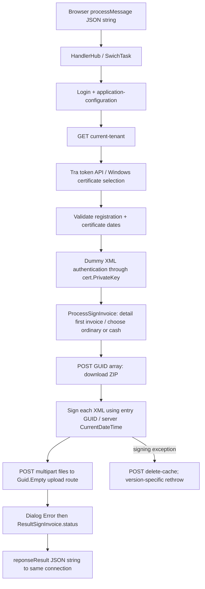

# Minvoice Windows và web app 2.0 — 22–23/10/2026

## Phạm vi ký nhiều hóa đơn, mục tiêu 300/lần

[Phân tích tổng quát](minvoice-bulk-signing.md) đã mở rộng ngoài sample 3:
cash chia 100 mỗi nhóm; 300 dự kiến 3 lượt tuần tự theo code đúng build.
Có model/biên/fault offline, chưa capture thật lô trên 100. App Mac hiện vẫn
có guard một invoice nên không coi nghiên cứu là tính năng đã tích hợp.

## Bổ sung capture ký lô ngày 23/10

Đã quan sát user ký lô **3 hóa đơn cash cùng mẫu/ký hiệu** thành công: backend
trả **một XML TDiep chứa ba HDon**, plugin tạo một Signature bao phủ DLieu rồi
upload một multipart part; server trả 204 và user xác nhận cả ba đổi trạng thái.
xmlsec verify đạt; sửa riêng dữ liệu của từng HDon đều bị từ chối. Không ép số
ZIP entries bằng số invoice IDs. Xem [batch report](minvoice-batch-live-capture.md)
và [evidence](evidence/minvoice-live-cash-batch-success.json). Đây là bổ sung cho
các đoạn “chưa quan sát batch” trong bản nghiên cứu trước; ordinary/mixed/partial
failure và callback envelope vẫn chưa được quan sát.

## Kết luận và phạm vi

**Plugin đang chạy trên Windows là 1.0.3.0, không phải artifact 1.1.1.0 của đợt nghiên cứu trước.** Web app gọi là 2.0 không đồng nghĩa assembly plugin mang version 2.0. Endpoint đang chạy có `handlerHub`/`processMessage` nhưng không có `getVersion`; artifact 1.1.1.0 mới có method này. Web bundle đã phân tích yêu cầu `minimumPluginVersion="1.1.1"` ở một số lệnh; chưa xác minh màn hình/tài khoản hiện tại dùng nhánh kiểm tra nào.

Đã xác định tĩnh luồng download → XMLDSig → multipart upload của cả hai build, khôi phục casing callback bằng metadata `JsonProperty`, và đo default XMLDSig bằng chương trình do analyst viết trên đúng Windows/.NET x86. Fixture được verify độc lập bằng xmlsec1 trên macOS. **Ngày 23/10 đã thu một giao dịch ký hóa đơn tiền mặt do user tự thao tác: download HTTP 200, upload HTTP 204 không body, user xác nhận UI báo thành công. XML thật verify bằng xmlsec1 trên macOS đạt; ba bản sao sửa nội dung/thời gian/chữ ký đều bị từ chối.** Xem [live cash evidence](evidence/minvoice-live-cash-success.json). Chưa quan sát ordinary HDon/BKe, batch/error semantics hoặc callback envelope thực.

Không thay USB, middleware, trust store hoặc proxy; không thu PIN hay đăng nhập hộ. Không chạy setup/installer. Đã resume VM hiện có để inventory; MinvoicePlug PID 10248 có sẵn sau resume. GET loopback `/signalr/hubs` là quan sát route đọc của process này. Probe riêng không load assembly vendor, không đọc store/token và chỉ ký dữ liệu giả bằng khóa phần mềm tạm. Không mở/đổi/đóng native target REA của nghiên cứu khác; không sửa core/FastCA hoặc worktree bridge.

## Identity và bằng chứng

| Đối tượng | Identity / phạm vi |
|---|---|
| Installed/running `MinvoicePlug.exe` | 1,693,384 B; assembly/file/product **1.0.3.0**; SHA-256 `4e891736c97f593f4306f56ce645f039ac91aa3e54ed01d81cb7b822093331e0`; MVID `00bd5b9b-4c09-43d5-a226-01047473e217`; .NET Framework 4.7.2, x86/prefer32 |
| ClickOnce manifest đang cài | `MinvoicePlug.manifest`, identity version **1.0.3.0**, SHA-256 `d63f968cc0306ab4d068adc0547f933206e7a7c4198543605b0a650a4efe1300` |
| Artifact nghiên cứu trước | Assembly **1.1.1.0**, 1,695,432 B; SHA-256 `57ffb22ea1c0555479d88bb120e9e1a09f8658b1fbab3378d9387c78cbc97a2c`; MVID `5e073e74-2075-482a-a5e1-f12cb1101106`; deployment đã lưu **1.0.9.3** |
| `/Users/linhsayshii/Downloads/setup.exe` | Hash kiểm tra lại `48392dffe6c187b145ced70d43474f89470ad50131817d0052e19fcc0ebcd69d`; đúng bootstrapper đã định danh trong [setup-clickonce.md](setup-clickonce.md), không phải assembly đang phân tích |
| Installed config | 7,604 B; SHA-256 `eb08690c5f895886d47d48f8b290c1193b486964d9259acc8797e44a8fe68713`; supportedRuntime v4.0/sku .NETFramework v4.7.2; không có AppContextSwitchOverrides trong config này |
| Installed dependency | SignalR.Core **2.4.3.0**; Newtonsoft.Json **12.0.0.0** (file 12.0.1.22727); System.Net.Http.Formatting **5.2.7.0**; xem inventory đầy đủ bên dưới |
| Guest runtime đo được | Windows 10.0.26100.8655 / Windows 11 ARM; CLR `4.0.30319.42000`; .NET Release `533320`; System.Security file `4.8.9332.0`, SHA-256 `5b0947d867dc177da5d2055ff04d4f0ce3eb769b057c5782e3551369179a64c9` |

`Get-AuthenticodeSignature` của file đang cài trả `Valid`, signer thumbprint `CE702677FDE51A37FF392A43ADC3E241DE636E0F`. Đây là kết quả policy guest tại thời điểm đo; không tuyên bố đã kiểm tra độc lập revocation/timestamp/chain cho build này.

REA 6.5.0 đã kết nối; tái sử dụng 6 records cũ bằng import, không setup/doctor lại. Evidence IDs:

- **I-ID** `ev_15d1e8b37b9aa88142c4db660f6765c1418421022108c720a0d36de795037e0f` — installed artifact metadata/identity.
- **I-MEM** `ev_aa5ce6721cdf82aa7c141d7db7e2a0a312e6a082c157ebf161ee25a28e559708` — installed member/CIL inventory.
- **F-MEM** `ev_ed9a7977eb392eff3984affe41e32e27fd6a8e21e65de454ca8e9eed4e2a7e1b` — installed System.Net.Http.Formatting, SHA-256 `7b58adc6e23b24cd6615b35e848a002bda053a26d48f9ddafacfc8098e97c49c`.
- **J-MEM** `ev_cd64468c53f821e4199fa00ad51b94360a947861146f9823ada2234ef9419889` — installed Newtonsoft.Json, SHA-256 `b66749b81e1489fcd8d754b2ad39ebe0db681344e392a3f49dc9235643bdbd06`.
- **N-MEM** `ev_491c880c5ab83760c01a4a0fb641f1c8aa050568de9e42c5d07b42d0b6577fc9` — prior 1.1.1.0; xem [minvoice-rest-static.md](minvoice-rest-static.md).

I-ID/I-MEM metadata và body coverage complete trong phạm vi parser; I-MEM `#US` partial do 17 terminal-flag anomalies, readable UTF-16 vẫn được giữ. Không dùng negative string search để chứng minh không có tính năng. CIL/token/EH coordinates luôn đi cùng SHA/MVID; kết luận flow dưới đây là diễn giải static, không phải decompiled source gốc hoặc execution trace.

Bằng chứng bền vững đã lọc:

- [Installed inventory](evidence/minvoice-windows-installed-inventory.json): toàn bộ filename/hash/version tại thư mục process, không dump config/log/session.
- [Installed CIL projection](evidence/minvoice-windows-installed-cil.json): selected raw IL, hashes, anchors, exception_regions, call edges; chỉ whitelist literal đường dẫn/header/XML/command.
- [JSON property attributes](evidence/minvoice-windows-json-properties.json): property rows + raw SerString blob, hash đối chiếu I-ID; là analyst projection, không Evidence ID mới.
- [Formatter CIL](evidence/minvoice-windows-formatter-cil.json): selected dependency methods, không chạy dependency.
- [Runtime observations](evidence/minvoice-windows-runtime-observations.json), [probe source](evidence/minvoice-dotnet-profile-probe.cs), [software XML fixture](evidence/minvoice-software-fixture.xml).

Full REA bundle và binary copy ở `.local/minvoice-windows-2.0/` bị Git bỏ qua, mode directory 0700/files 0600. Bundle đầy đủ có thể chứa constant credential vendor nên không commit. Runtime records ở trên do analyst thu bằng Parallels/PowerShell và xmlsec1, **không có REA runtime Evidence ID**.

## Entry point, phiên và callback

Quan sát runtime GET `http://127.0.0.1:16080/signalr/hubs`: PID 10248 listen `127.0.0.1:16080`; proxy text có `handlerHub`, `processMessage`, không có `getVersion`; SHA-256 text UTF-8 `43d2f56bc25a51440bc6cd2938637a8c516858055f2961291c72f66a02f871f3`. Trong bước đọc hub, agent không gọi lệnh ký/TokenInfo/Login. Giao dịch live bên dưới do user tự bấm ký; relay không tự khởi tạo command.

Theo web bundle đã lưu, browser gọi `processMessage` với **một JSON string**:

```json
{"BrowserInfo":{"Cookie":"<redacted>","UserAgent":"<browser>","UserName":"<redacted>","Pass":"<redacted>","LinkApi":"https://api-hddt.minvoice.com.vn/api/app/"},"PlugCommand":{"CommandName":"SignInvoices","InvoiceIdArray":["<GUID>"],"SerialNumber":"<certificate serial>"}}
```

I-MEM `HandlerHub.GetCommandInfo` 0x0600000e: JObject.Parse → ToObject<CommandInfo> → GlobalData.commandInfo. `<SwichTask>d__2.MoveNext` 0x060003eb gọi Login tại IL_011e rồi nhánh `SignInvoices` tại IL_02ce. `<ProcessMessage>d__0.MoveNext` 0x060003e8 đặt Code=1/Message=Successful, await SwichTask, gán Data; callback `reponseResult(ConvertString(result))` **chỉ tới Context.ConnectionId**, IL_01cd..01f2. ConvertString 0x06000264 dùng JsonConvert.SerializeObject.

JsonProperty blobs xác nhận `Code→code`, `Message→message`, `ErrorName→errorName`, `Data→data`, `Command→command`, `Status→status`. Code có kiểu RestResultCode và JsonConverterAttribute: JsonEnumConverter.WriteJson 0x0600031e parse/box enum rồi gọi JsonWriter.WriteValue(object), không trực tiếp ghi tên enum thành string. Cùng với kiểm tra số `code===1` trong web bundle, đây là cơ sở cho code số của envelope dưới đây. `ResultSignInvoice` 0x06000209 kế thừa HubResultData, ctor đặt Command=SignInvoices; chỉ có Status riêng. Kết quả thành công **dựng từ static flow**, không phải captured response:

```json
{"code":1,"message":"Successful","errorName":null,"data":{"status":true,"command":"SignInvoices"}}
```

Không có signed XML, certificate hoặc per-invoice results trong DTO này. ProcessMessage catch RestException lấy Code/Message; catch Exception còn lại đặt code=2/Message=ex.Message. Method này không gán ErrorName từ exception. Chưa xác minh setting Json.NET bên ngoài có ảnh hưởng null omission hay wire property order; consumer nên đọc theo key, không theo thứ tự. `code===1` là điều kiện resolve của web bundle.

Không có request correlation ID riêng trong envelope/callback. Correlation browser dựa trên connection và orchestration của trang. `x_req_id` của REST là GUID mới, không phải InvoiceId hay callback ID. Vendor dùng GlobalData singleton; không suy nó an toàn cho nhiều lệnh đồng thời.

## Luồng ký



I-MEM `<SignInvoices>d__2.MoveNext` 0x06000483: new InvoiceApiService(BrowserInfo), CurrentTenant, GetToken(SerialNumber), ShowAuthencationToken, dialog ProcessSignInvoice; khi Error khác null thì throw, ngược lại Status=true. `bgwProgress_DoWork` 0x060003d0 chọn ordinary/cash bằng InvoiceSerial của **hóa đơn đầu tiên**; không chứng minh hỗ trợ batch trộn serial/profile.

GetToken 0x06000380 thử API/local cert theo serial đã gửi, rồi fallback default token, cuối cùng picker Windows. ValidateToken 0x0600037f gọi API registration, lỗi 9008 nếu thiếu; parse tenant CurrentDateTime format `yyyy-MM-ddTHH:mm:ss`, so NotBefore/NotAfter, lỗi 9009 nếu ngoài hạn. Có thể fallback sang cert khác nếu serial ban đầu không resolve: macOS nên yêu cầu user xác nhận cert cụ thể, không tự chọn thay.

ShowAuthencationToken 0x0600035c gọi AuthencationTokenPasswordDefault 0x0600035d và có thể ComputeSignatureTemp 0x0600035e. Cả hai ký dummy `<a></a>` bằng cert.PrivateKey; **không thấy truyền default PIN trong các method này**, dù tên gợi như vậy. Không tái hiện thao tác ký ngầm này trong TokenSigner; mọi chữ ký của bridge cần approval và PIN chỉ stdin helper.

### Contract REST của installed 1.0.3.0

Base invoice API là BrowserInfo.LinkApi, không phải literal tenant duy nhất. Base login/bootstrap là LinkApi.Replace("app/", ""). Bảng dưới ghi relative paths; auth/session headers nói sau bảng.

| Bước | Method/path | Body và response static | I-MEM token |
|---|---|---|---|
| Login | POST `account/login` dưới base bỏ `app/` | RequestLoginModel UserNameOrEmailAddress/Password/RememberMe=false; response body success không được dùng, giữ Set-Cookie | 0x06000066 |
| Bootstrap XSRF | GET `abp/application-configuration` dưới base bỏ `app/` | SaveCookies lần nữa | 0x06000067 |
| Tenant | GET `tenant-company/current-tenant` | TenantCompanyModel, dùng CurrentDateTime; null → 9011 | 0x06000078 |
| Token serial/default | GET `token/by-serial-number?serialNumber={0}` / `token/default-sign-usb` | Token DTO; chưa có sample response thực | 0x0600007d/7e |
| Detail đầu batch | GET `invoice/{GUID}/detail` | Các key metadata: registerInvoiceId, relatedInvoiceId, invoiceStatus, invoiceSerial, invoiceNumber; null → 9020 | 0x06000079 |
| Chunk setting | GET `release-invoice/tenant-setting-sign` | Value→Convert.ToInt32; default ordinary chunk 2 | 0x0600007c / 0x060003dd |
| Download ordinary | POST `release-invoice/download-xml` | JSON array GUID → ZIP `<GUID>.xml` | 0x06000073/74 / 0x060003db |
| Download cash | POST `release-invoice/download-xml-invoice-cash` | JSON array GUID → ZIP; cash chunk 100 | 0x06000071 / 0x060003d2/3dc |
| Cleanup khi ký lỗi | POST `release-invoice/delete-cache` | JSON array requested GUID; body/status response không được parse tại DeleteCacheInvoice | 0x06000072; handler IL_00c0..00d0 của 0x060003db/3dc |
| Batch upload | POST `release-invoice/00000000-0000-0000-0000-000000000000/upload-xml` | UTF-8 multipart, field `files`, filename `<GUID>.xml`, part type `text/xml`; await byte[] response | 0x06000419 |

PostFile 0x06000093 dùng PostAsJsonAsync → CustomEnsureSuccessStatusCodeFile → ReadAsStreamAsync. Download không phải `{InvoiceIds:[...]}` hay raw XML. GetSignedInvoices đọc ZipArchive/StreamReader, entry.Name.Replace(".xml", "") → Guid.Parse; không extract ra filesystem. Runtime MIME/charset/size limits, ZIP entry correlation thực vẫn chưa có.

Multipart boundary là GUID bỏ `-`; từng part có CRLF, closing `--boundary--\r\n`. WebClient.Encoding=UTF8 ở ctor 0x06000080. URL Guid.Empty được chứng minh bằng ldsfld Guid.Empty, không suy từ một URL ví dụ. Upload method không parse byte[] thành result nghiệp vụ; SignInvoice chờ Task.Result. HTTP success/callback status=true không tự chứng minh mọi hóa đơn được phát hành.

**Auth/header:** InvoiceBusiness.Login 0x06000374 reset verification token, chỉ lấy cookie `__tenant` từ BrowserInfo.Cookie, rồi đăng nhập bằng BrowserInfo.UserName/Pass. SaveCookies 0x06000068 giữ Set-Cookie khác `__tenant`; lấy XSRF-TOKEN value làm RequestVerificationToken. InvoiceApiService(BrowserInfo) ctor 0x06000063 dùng HttpClientHandler.UseCookies=false; thêm `User-Agent`, `Cookie`, `RequestVerificationToken`. Upload WebClient dùng cùng ba header; không có x_req_id trong ctor/upload được chọn. Download và delete-cache dùng Headers.Add(`x_req_id`, GUID mới); nó có thể tích lũy nhiều value khi reuse client qua batch, chưa đo wire. Không có Bearer/api-key trên đường ctor/request này.

**Login casing:** F-MEM PostAsJsonAsync 0x06000055→56 tạo JsonMediaTypeFormatter mới; ctor 0x06000274→0x060001f5 tạo JsonContractResolver, CreateDefaultSerializerSettings 0x060001fb gán resolver, CreateJsonSerializer 0x06000204 dùng JsonSerializer.Create(settings). J-MEM DefaultContractResolver ctor 0x0600060f không đặt NamingStrategy; ResolvePropertyName 0x0600063b trả nguyên tên nếu NamingStrategy null. RequestLoginModel không có JsonProperty đổi tên trong attribute inventory. Vì vậy static reconstruction của installed build là `{"UserNameOrEmailAddress":"<redacted>","Password":"<redacted>","RememberMe":false}`; chưa có HTTP capture xác nhận bytes/thứ tự/charset.

**Lỗi:** Login HTTP fail → 9014. PostFile HTTP fail đọc HTML `<h1>` qua GetErrorMessage/GetErrorCode 0x0600026c/26d, map message/error code, fallback code 9999. Upload WebClient failure đi qua exception/task/dialog; không có parser upload per-invoice result ở các method này. Chưa đo error body/ABP response thực hay cancel mid-batch.

### Khác biệt phiên bản có ý nghĩa

| Câu hỏi | Installed 1.0.3.0 | Prior 1.1.1.0 |
|---|---|---|
| GetVersion | Không có trong metadata và live hub proxy | HandlerHub.GetVersion 0x0600000b đọc AppConfig.AppVersion |
| Ordinary placement | Chỉ `//HDon/DSCKS/NBan` | IsBKeXml 0x060003dd chọn thêm `//BKe/DSCKS/NBan`, kể cả GUID backend sinh ngoài requested set |
| Ký XML lỗi | 0x060003db EH catch tại IL_00c0, gọi delete-cache tại IL_00c9 rồi **leave/return**, không rethrow | 0x060003dc EH catch tại IL_0142, delete-cache IL_014b rồi **rethrow IL_0151** |
| Download RestException chứa “cập nhật” | Không có nhánh trong ExecSignInvoice đã chọn | 0x060003dc IL_0044..008b gọi CheckUpdate rồi rethrow |
| SignXmlData thiếu XPath | Không precheck vị trí trước ComputeSignature trong method này | 0x060003a0 kiểm tra target count và throw trước khi lấy PrivateKey |

`delete-cache` **không phải request thành công bắt buộc trước upload** trong cả hai build. Nhận định này đã được đối chiếu exception_regions, không chỉ call list. Ở 1.0.3.0 việc nuốt lỗi ký rồi trả danh sách có thể khiến upload nhận list chưa ký hết; đây là hệ quả suy ra từ control flow, chưa phải lỗi từng quan sát trên backend. Bridge phải fail trước upload khi có bất kỳ chữ ký/verification thất bại.

## XMLDSig: static + controlled replay

I-MEM SignFile.ExecSignXmlInvoice 0x0600039d → SignXmlData 0x0600039f; N-MEM tương ứng 0x0600039e/3a0. Cả hai tạo InvoiceSignXml; ctor installed 0x0600030e chỉ gọi SignedXml(XmlDocument). GetIdElement 0x0600030f tìm `//*[@Id='<id>']`, rồi fallback base; không override thuật toán. Không suy SHA-256 từ string của VoucherSign.

| Thành phần | Bằng chứng/kết quả |
|---|---|
| XML whitespace | PreserveWhitespace=true trước LoadXml |
| Document reference | `URI="#<ZIP entry GUID>"`; cần XML có Id tương ứng; cash live xác nhận target `/TDiep/DLieu` với Id đã có trong ZIP; ordinary chưa capture |
| Transforms reference tài liệu | Enveloped-signature, rồi inclusive C14N |
| SignedInfo C14N | Replay đo `http://www.w3.org/TR/2001/REC-xml-c14n-20010315` |
| SignatureMethod | Không set trong vendor method; replay .NET x86 target 4.7.2 trên guest đo `http://www.w3.org/2001/04/xmldsig-more#rsa-sha256` |
| DigestMethod hai Reference | Không set trong vendor method; replay đo `http://www.w3.org/2001/04/xmlenc#sha256` |
| SigningTime | Text nguyên từ CurrentTenant.CurrentDateTime, không đổi UTC trong đường invoice này; format validator `yyyy-MM-ddTHH:mm:ss` |
| Time Object | XMLDSig `<Object Id="signtime">`; reference thứ hai URI="#signtime", không thêm Transform trong wire; canonicalization ngầm của default runtime |
| Time subtree | `<SignatureProperties xmlns=""><SignatureProperty Target="#signtime"><SigningTime>…</SigningTime></SignatureProperty></SignatureProperties>`; **ba phần tử không có namespace XMLDSig** trong replay |
| KeyInfo | KeyInfoX509Data(cert) + AddSubjectName; replay có X509SubjectName và X509Certificate; không có RSAKeyValue trong method invoice |
| Signature placement | Ordinary HDon/NBan; 1.1.1.0 có BKe/NBan; cash TDiep/CKSNNT |
| Cash Id | ExecSignXmlInvoiceCash 0x0600039e tìm `//TDiep//DLieu`; nếu thiếu node trả empty string; nếu thiếu Id thì thêm entry GUID, giữ Id cũ nếu có; rồi cùng SignXmlData |

Probe source chỉ tái hiện chuỗi API bằng khóa software và XML giả `DLHDon Id=12345678-90ab-cdef-1234-567890abcdef`. Nó không xác nhận backend thực dùng element DLHDon hay cert CSP nào. Probe chạy x86, target-framework attribute + startup sku 4.7.2; default library là System.Security file 4.8.9332.0. Không load MinvoicePlug/Newtonsoft/formatter trong replay.

Kết quả `CheckSignature(key)=True`; độc lập trên macOS:

```sh
xmlsec1 --verify --pubkey-cert-pem .local/minvoice-windows-2.0/fixture-cert.pem \
  --id-attr:Id DLHDon --id-attr:Id Object \
  docs/re/evidence/minvoice-software-fixture.xml
# Verification status: OK
```

Chỉ dùng public certificate fixture làm verification key, không kiểm tra trust/validity của cert fixture. SHA-256 fixture `e2f179492af2a4fb3faffc8dcee7fbf839e88f59ad17f83f06d52d8480a21bf8`; source probe `cc5108b21a0773c587802fdb8f4fcab8277d2e826807f244f7d3586681d38897`. Private key không export/persist/log. Probe riêng không chứng minh runtime AppContext/provider của process MinvoicePlug giống hoàn toàn. Signed XML live cash ngày 23/10 bên dưới đã xác nhận profile cho đúng một giao dịch của build đang cài.

## Live cash ngày 23/10/2026

[Evidence đã che thông tin](evidence/minvoice-live-cash-success.json) ghi nhận tám
request hoàn tất trong khoảng **00:24:42–00:24:49 giờ Việt Nam**: login 200,
application-configuration 200, current-tenant 200, token/by-serial-number hai lần
200, invoice detail 200, download-xml-invoice-cash 200 và upload-xml 204 với body
rỗng. Không có delete-cache hay relay failure trong run này. User xác nhận giao
diện Minvoice báo ký thành công. Callback `reponseResult` của giao dịch này chưa
được thu; không nâng casing/envelope tĩnh thành runtime observation.

Đây là controlled relay v3: browser đổi LinkApi của đúng một command user tự
khởi tạo sang nonce loopback; relay chuyển tới cố định HTTPS upstream. Không phải
passive capture TLS nguyên trạng. Plugin vẫn đúng SHA/version 1.0.3.0 đã inventory.
ZIP 1.642 B chứa một file GUID.xml, unsigned XML 3.951 B; multipart 7.411 B chứa
field `files`, filename trùng ZIP entry, Content-Type `text/xml`, signed XML
7.210 B. Raw ZIP/XML/certificate/multipart chỉ ở private `.local`, không commit.

Live XML xác nhận root `TDiep`, signature `/TDiep/CKSNNT/Signature`; document
reference trỏ `/TDiep/DLieu` bằng entry GUID. Id đã tồn tại trong unsigned XML,
không cần thêm trong giao dịch này. Sau khi bỏ Signature, toàn bộ cấu trúc,
attribute, text và whitespace của XML gốc không đổi qua phép so sánh parsed tree.
Profile khớp replay: inclusive C14N, RSA-SHA256, hai digest SHA256; document
reference có enveloped-signature rồi C14N, time reference `#signtime` không
Transform tường minh; Object thuộc XMLDSig, ba phần tử time không namespace,
Target="#signtime", thời gian có giây và không timezone. KeyInfo chỉ X509Data
chứa X509SubjectName rồi X509Certificate, không RSAKeyValue.

xmlsec1 1.3.12 (openssl) verify **đúng signed XML gốc** với public certificate
trích từ chính XML. Dùng `--lax-key-search` để chọn sole explicit verification
key, `--enabled-reference-uris same-doc`, `--id-attr:Id DLieu` và
`--id-attr:Id Object`. Lần thử strict key lookup ban đầu báo KEY-NOT-FOUND nên
chưa chạy kiểm tra chữ ký; đây không phải bằng chứng chữ ký sai. Chạy chọn key
tường minh đạt `Verification status: OK`; các bản sao chỉ sửa riêng dữ liệu hóa
đơn, SigningTime hoặc SignatureValue đều fail. Không kiểm tra certificate chain,
revocation hoặc tự query trạng thái nghiệp vụ. Không suy toàn bộ HDon/BKe/batch
được hỗ trợ từ giao dịch cash đơn này.

## Tích hợp macOS và phần còn thiếu cụ thể

Tại snapshot nghiên cứu tĩnh ngày 22/10, worktree `.claude/worktrees/beautiful-shirley-8acdc0` có MinvoiceBridge getVersion/TokenInfo và default 501; MinvoiceRESTRequests chỉ dựng request, chưa transport/login. Không build/test hay sửa worktree này trong đợt nghiên cứu.

Core XMLDSigSigner hiện có `#SigningTime`, Target="#signature-id", ds:SignatureProperties/ds:SignatureProperty, thêm RSAKeyValue và không có X509SubjectName. Vì vậy **không thể nối nguyên signer hiện tại rồi coi là cùng profile Minvoice**, dù chữ ký XMLDSig tổng quát có thể hợp lệ. Giữ core/FastCA nguyên; bổ sung profile Minvoice riêng tại bridge/adapter trong checkout được giao riêng khi triển khai.

Phần đủ căn cứ để triển khai offline: DTO request/callback với casing đã xác định; auth URL/session parser có allowlist; ordinary/cash request builder; ZIP reader trong bộ nhớ với giới hạn archive/entry/decompression, basename GUID và chặn duplicate; XML profile riêng theo bảng trên; verify trước upload; state machine fail-closed và không tự retry upload. Giữ URI/Id/namespace/time theo fixture thay vì sửa generic core. Điều kiện cho bảng kê phải theo profile 1.1.1.0, không ép tất cả ZIP IDs bằng tập requested IDs. Khóa PKCS#11 chọn theo serial đã duyệt; ký DigestInfo SHA-256 bằng CKM_RSA_PKCS, approval trước ký và PIN stdin helper.

Phần chưa đủ để bật phát hành:

1. **Runtime transaction identity:** đã xác nhận build 1.0.3.0 trong giao dịch cash thành công. Nếu user tự cập nhật plugin, inventory/hash lại, không dùng token offsets build cũ.
2. **Download sample:** đã có ZIP cash thật và mapping entry GUID → DLieu Id. Còn thiếu ZIP ordinary có HDon/BKe nếu có, auxiliary-entry rules và batch ngoài một invoice.
3. **Signed XML từ plugin:** đã verify live cash và chốt URI/algo/namespace/time/KeyInfo/placement cho sample này. HDon/BKe và fallback thêm Id mới chỉ được xác định tĩnh.
4. **Upload response:** success cash quan sát HTTP 204/body rỗng + user UI success. Lỗi từng invoice, partial batch, network interruption/cancel và idempotency/rollback còn chưa biết; không tự retry hoặc gọi delete-cache như bước thành công.
5. **Login/bootstrap:** đã thu status/schema/header-presence đã che thông tin trong luồng plugin thực. Request JSON casing còn dựa static vì không lưu raw login body; numeric result của login không lưu. Agent không tự login hay đọc credential từ browser.

Inventory uninstall registry HKCU/HKLM (cả WOW6432Node) không thấy Fiddler/mitmproxy/Charles/Wireshark đã đăng ký; đây không loại trừ bản portable. REA đang có offline HAR/SAZ inspection, chưa có live HTTP capture session. Không cài proxy root CA hoặc đổi system proxy. Sau bước inventory này đã dùng controlled loopback relay như phần live; không tuyên bố passive HTTPS capture.

Các lần quan sát mở rộng ngoài cash sample này cần làm theo thứ tự: (a) chốt hash plugin; (b) chuẩn bị một capture process được user kiểm soát, công khai phạm vi proxy/trust trước khi thay đổi; (c) user tự chọn đúng một hóa đơn test và tự thao tác/PIN, agent không bấm Ký/phát hành; (d) giữ đầy đủ lifecycle login/bootstrap/download/upload/callback nhưng loại credential khỏi mọi export/log; (e) inspect HAR/SAZ offline và so với contract/fixture này. DevTools của tab chỉ thấy browser→SignalR; nó không thu request HTTPS do process .NET gửi. Không yêu cầu chuyển token FastCA khỏi Mac trong bước chuẩn bị.

## Checklist cuối đợt

| Câu hỏi | Trạng thái |
|---|---|
| Plugin nào đang cài/chạy? | Đã xác nhận file/hash/assembly/manifest + live hub |
| Entry point, command, callback envelope? | Web bundle trước + exact CIL/JsonProperty installed; chưa capture callback ký thật |
| Download/upload/auth contract? | Static hai build; cash live có đủ bootstrap/download 200/upload 204 và user UI success; login casing/ordinary/batch còn giới hạn |
| XML profile? | Live cash khớp replay, xmlsec1 verify đạt, ba negative controls fail; ordinary/BKe chưa có live sample |
| Error/batch/correlation? | Static flow đã rõ thêm, gồm khác biệt rethrow; server partial/idempotency chưa biết |
| Bật SignInvoices trong app? | Chưa; giữ 501. Có fixture/probe và kế hoạch cụ thể để triển khai profile riêng, không sửa core đang dùng ở nghiên cứu khác |

Validation cuối đợt: đối chiếu 67 raw IL hashes với I-MEM, 52 JsonProperty blob hashes với I-ID và executable copy với guest inventory đều đạt; fixture .NET verify và xmlsec1 verify đều đạt. [Integrity manifest](evidence/minvoice-windows-evidence-manifest.json) ghi SHA-256/length các file evidence mới. Không chạy lại Swift suite vì chưa sửa source app; kết quả 81 tests ở tài liệu trước không phải một lần chạy của đợt này.
